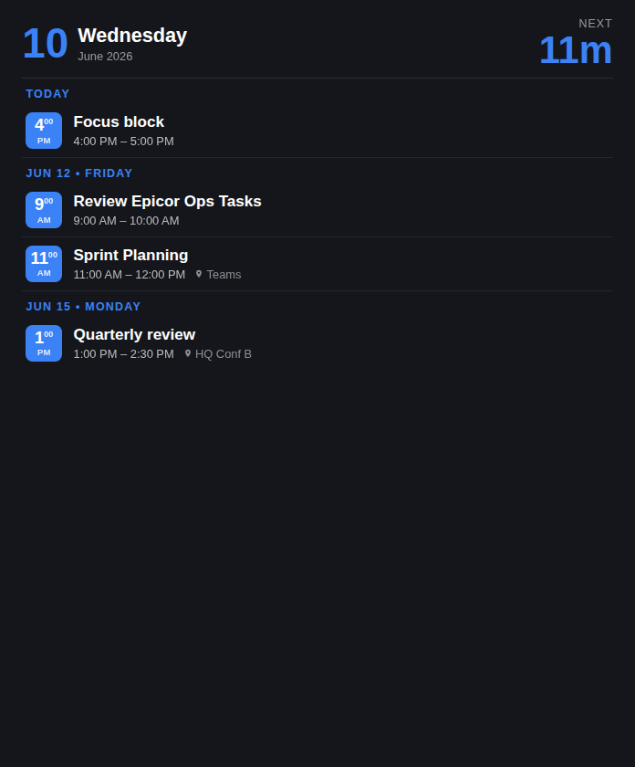

# Outlook Calendar — iCUE Widget for Xeneon Edge

An agenda-style Outlook calendar for the CORSAIR Xeneon Edge: dark theme, accent **time tiles** per event, day separators (*Today / Tomorrow / Jun 12 • FRIDAY*), locations, a highlighted *happening now* row, and a **next-event countdown** in the header.

Microsoft Graph has no static API keys, so this widget pairs with **[xeneon-graph-proxy](https://github.com/joshuawowk/xeneon-graph-proxy)**. The proxy can be fed two ways:

1. **Graph device-code sign-in** (if your tenant permits public clients)
2. **Browser-scrape ingest** — a scheduled browser session reads Outlook Web in your signed-in profile and POSTs normalized JSON to the proxy's `/ingest/calendar` endpoint. Useful when corporate tenants block OAuth app registrations.

## Features

- Agenda for the next 1–14 days, grouped by day with locale-aware times
- Header: today's date + live countdown to the next event ("25m", "2h 15m"); turns red **busy** during a meeting
- *Happening now* row highlight
- Optional hiding of all-day events
- Offline resilience (last good data with an `offline` tag)
- Responsive: all Xeneon Edge slots; two/three-column agenda on L/XL horizontal
- Personalization: colors, background image, glass blur, transparency

## Setup

1. Deploy [xeneon-graph-proxy](https://github.com/joshuawowk/xeneon-graph-proxy) (Docker, port 8585) and authenticate or set up the scrape sync
2. `icuewidget package icue-widget-outlook-calendar` → double-click to install (iCUE 5.44+)
3. Add to a Xeneon Edge slot; adjust **Proxy URL** if needed

## Settings

| Setting | Type | Default | Description |
|---------|------|---------|-------------|
| Proxy URL | text | `http://localhost:8585` | Where xeneon-graph-proxy runs |
| Days Ahead | slider | 5 | 1–14 |
| Hide All-Day Events | switch | off | |
| Refresh Interval | slider | 5 min | 1–30 min |
| Text / Accent / Background Color | color | white / `#3b82f6` / `#15161c` | |
| Background Image + Glass Blur | media | — | |
| Background Transparency | slider | 100% | |

## States

Loading · Waiting for data (proxy has no calendar yet) · Empty ("Nothing scheduled") · Error (proxy unreachable) · Content

## License

MIT
